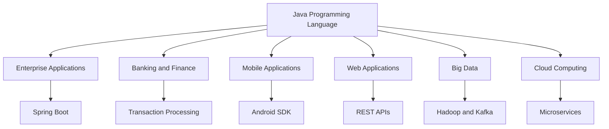

# Java Features and Real-World Applications

## 1. Introduction

Java is a high-level, object-oriented, platform-independent programming language developed by James Gosling and his team at Sun Microsystems. It was officially released in 1996.

Java is widely used for developing enterprise applications, banking systems, web applications, Android applications, cloud services, and distributed systems.

## 2. History and Evolution of Java

Java has evolved significantly since its initial release. Each version introduced improvements in performance, security, developer productivity, and application development.

| Java Version | Release Year | Major Features and Improvements |
|---|---|---|
| Java 1.0 | 1996 | Initial release, JVM, basic language features |
| Java 1.1 | 1997 | Inner classes, JDBC, RMI |
| Java 1.2 | 1998 | Collections Framework, Swing |
| Java 1.3 | 2000 | Performance improvements, HotSpot JVM |
| Java 1.4 | 2002 | Assertions, regular expressions, NIO |
| Java 5 | 2004 | Generics, annotations, enums, enhanced for-loop |
| Java 6 | 2006 | Compiler API, scripting support, performance improvements |
| Java 7 | 2011 | Try-with-resources, diamond operator, switch improvements |
| Java 8 (LTS) | 2014 | Lambda expressions, Stream API, Optional, Date and Time API |
| Java 9 | 2017 | Module System, JShell |
| Java 10 | 2018 | Local variable type inference (`var`) |
| Java 11 (LTS) | 2018 | Standard HTTP Client, String methods |
| Java 12 | 2019 | Switch expressions (preview) |
| Java 13 | 2019 | Text blocks (preview) |
| Java 14 | 2020 | Records (preview), switch expressions |
| Java 15 | 2020 | Text blocks, sealed classes (preview) |
| Java 16 | 2021 | Records, pattern matching for instanceof |
| Java 17 (LTS) | 2021 | Sealed classes, enhanced pattern matching |
| Java 18 | 2022 | Simple Web Server, UTF-8 by default |
| Java 19 | 2022 | Virtual threads (preview), record patterns (preview) |
| Java 20 | 2023 | Pattern matching and virtual threads improvements |
| Java 21 (LTS) | 2023 | Virtual threads, record patterns, sequenced collections |
| Java 22 | 2024 | Foreign Function and Memory API, unnamed variables |
| Java 23 | 2024 | Markdown documentation comments (preview), language improvements |
| Java 24 | 2025 | Generational ZGC improvements, security and performance enhancements |
| Java 25 (LTS) | 2025 | Module import declarations, compact source files, flexible constructor bodies |

**Note:** LTS stands for Long-Term Support. These releases receive extended maintenance and support. Java 21 and Java 25 are important LTS releases, with Java 25 being the latest LTS release as of November 2026.

## 3. Key Features of Java with Examples

### 3.1 Platform Independence

Java follows the principle of Write Once, Run Anywhere (WORA). Java source code is compiled into bytecode, which can run on any operating system with a compatible JVM.

**Example:**

```java
public class HelloWorld {
    public static void main(String[] args) {
        System.out.println("Hello, Java!");
    }
}
```

The same compiled bytecode can run on Windows, Linux, and macOS with a compatible JVM.

### 3.2 Object-Oriented Programming

Java supports object-oriented programming concepts such as encapsulation, inheritance, polymorphism, and abstraction. These concepts help developers create reusable and maintainable applications.

**Example:**

```java
class Employee {
    String name;

    void display() {
        System.out.println("Employee: " + name);
    }
}

public class Main {
    public static void main(String[] args) {
        Employee employee = new Employee();
        employee.name = "Rahul";
        employee.display();
    }
}
```

**Real-world application:** Employee management systems, banking applications, and enterprise software.

### 3.3 Simple and Easy to Learn

Java has a readable syntax inspired by C and C++. It removes complex features such as explicit pointer manipulation and manual memory deallocation.

**Example:**

```java
public class Main {
    public static void main(String[] args) {
        int firstNumber = 10;
        int secondNumber = 20;

        int sum = firstNumber + secondNumber;

        System.out.println("Sum: " + sum);
    }
}
```

### 3.4 Security

Java provides security features such as bytecode verification, access modifiers, class loading mechanisms, and type safety.

**Example:**

```java
class BankAccount {
    private double balance = 5000;

    public double getBalance() {
        return balance;
    }
}
```

The private access modifier prevents direct access to the account balance from outside the class.

**Real-world application:** Banking systems, payment applications, and financial software.

### 3.5 Robustness

Java provides exception handling, strong type checking, and automatic memory management to help developers build reliable applications.

**Example:**

```java
public class Main {
    public static void main(String[] args) {
        try {
            int result = 10 / 0;
        } catch (ArithmeticException e) {
            System.out.println("Cannot divide by zero");
        }
    }
}
```

### 3.6 Multithreading

Java supports multithreading, allowing multiple tasks to execute concurrently. This improves application responsiveness and resource utilization.

**Example:**

```java
public class Main {
    public static void main(String[] args) {
        Thread thread = new Thread(() -> {
            System.out.println("Background task running");
        });

        thread.start();
    }
}
```

**Real-world application:** Online transaction processing, background jobs, and server applications.

### 3.7 High Performance

Java uses Just-In-Time (JIT) compilation to convert frequently executed bytecode into native machine code, improving application execution performance.

**Example:**

```java
public class Main {
    public static void main(String[] args) {
        long start = System.currentTimeMillis();

        for (int i = 0; i < 1000000; i++) {
            int result = i * 2;
        }

        long end = System.currentTimeMillis();

        System.out.println("Execution time: " + (end - start));
    }
}
```

### 3.8 Automatic Memory Management

Java automatically manages memory through garbage collection. Objects that are no longer reachable can be reclaimed by the garbage collector.

**Example:**

```java
public class Main {
    public static void main(String[] args) {
        String message = new String("Hello Java");

        message = null;

        System.gc();
    }
}
```

`System.gc()` only requests garbage collection; it does not guarantee immediate execution.

### 3.9 Distributed Programming

Java provides networking APIs that allow applications to communicate and exchange data across different systems.

**Example:**

```java
import java.net.URL;

public class Main {
    public static void main(String[] args) throws Exception {
        URL url = new URL("https://example.com");

        System.out.println("Protocol: " + url.getProtocol());
        System.out.println("Host: " + url.getHost());
    }
}
```

### 3.10 Collections Framework

Java provides collection classes such as ArrayList, HashSet, HashMap, and LinkedList to store and manage groups of objects.

**Example:**

```java
import java.util.ArrayList;

public class Main {
    public static void main(String[] args) {
        ArrayList<String> students = new ArrayList<>();

        students.add("Rahul");
        students.add("Priya");
        students.add("Amit");

        for (String student : students) {
            System.out.println(student);
        }
    }
}
```

## 4. Real-World Applications of Java

### 4.1 Banking and Financial Applications
Java is used to develop secure banking applications, transaction processing systems, payment gateways, and account management platforms.

### 4.2 Enterprise Applications
Java frameworks such as Spring Boot and Hibernate help developers build scalable enterprise applications, business management systems, and REST APIs.

### 4.3 Android Applications
Java has been widely used for Android application development with the Android SDK.

### 4.4 E-Commerce Applications
Java supports product management, inventory tracking, order processing, payment processing, and customer management.

### 4.5 Big Data Applications
Java is used in technologies such as Apache Hadoop and Apache Kafka to process and manage large amounts of data.

### 4.6 Cloud-Based Applications
Java is used to build cloud-native applications, microservices, distributed systems, and backend services.

## 5. Java Applications Diagram

The following diagram illustrates major areas where Java is used.



## 6. Advantages of Java

- Platform independence.
- Object-oriented programming support.
- Strong security mechanisms.
- Automatic memory management.
- Built-in multithreading support.
- Large collection of libraries and frameworks.
- Strong community support.
- Suitable for enterprise-level applications.

## 7. Conclusion

Java remains an important programming language for modern software development. Its platform independence, object-oriented approach, security, multithreading, and automatic memory management make it suitable for developing reliable and scalable applications.

From its initial release in 1996 to modern LTS releases such as Java 21 and Java 25, Java has continuously evolved to meet the requirements of modern software development.

## 8. References

1. Oracle Java Releases: https://www.oracle.com/java/technologies/downloads/
2. Oracle Java SE Support Roadmap: https://www.oracle.com/java/technologies/java-se-support-roadmap.html
3. Java Documentation: https://docs.oracle.com/en/java/
4. OpenJDK: https://openjdk.org/
